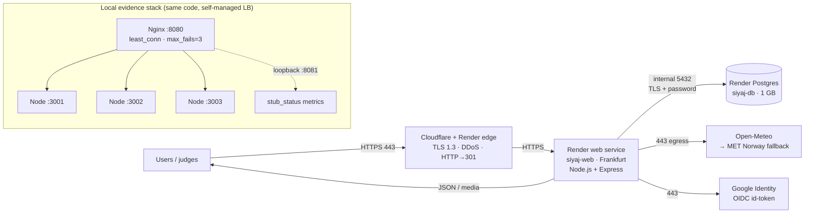

# Architecture Blueprint — Siyaj Solar Guardian on Render

**Enterprise Cloud-Native Architecture Hackathon 2026**
**Submission:** InnovationFest secure, scalable submission platform (implemented through the Siyaj application)
**Public endpoint:** https://siyaj-web.onrender.com
**Repository:** https://github.com/MrTHNR67/hussin-web
**Date:** 11 November 2026

---

## 1. Problem and solution

InnovationFest expects 20,000 participants across 100 institutions. The previous platform failed near
the submission deadline: the site became unavailable, large uploads slowed everything, users could
reach other teams' documents, and peak infrastructure kept running after demand fell.

This submission takes a working application (Siyaj Solar Guardian) and hardens it into a cloud-native
service that answers each failure mode:

| Failure in the scenario | Control in this solution | Evidence |
|---|---|---|
| Site unavailable at peak | 3 replicas behind a load balancer, passive health checks, bounded autoscaling | `docs/evidence/task2-ha-task3-lb.md`, `task4-autoscaling.md` |
| Large uploads slow the site | upload size limits (25 MB), per-user media storage, validation before analysis | `server.mjs` (`/api/account/media`), Task 1 evidence |
| Users read other teams' documents | per-user data isolation, row-level security, session checks on every read | `server/data-store.mjs`, `docs/iam.md` |
| Manual file checks | automated validation pipeline (`validatePanelMedia`, `validateInvoiceImages`) with structured status | `/api/panel/analysis`, `/api/analyze-invoice` |
| Peak capacity kept running | scale-in policy to a 3-replica floor after load, free-tier hosting | Task 4 evidence, Task 7 cost model |

The application itself is a solar-panel monitoring assistant: users upload panel/invoice images,
receive validated analyses, track heat loss and weather, and get daily alerts. The same patterns
(private uploads, per-user isolation, validated documents, background jobs) map directly to the
InnovationFest submission workflow.

---

## 2. Architecture



Text form:

```text
Internet
  │ HTTPS 443 (TLS 1.3)
  ▼
Cloudflare/Render edge ── 301 from :80, DDoS, managed certificate
  │
  ▼
Render web service (Frankfurt, free plan, auto-deploy from main)
  ├── stateless Node.js + Express process
  ├── /healthz (liveness) and /readyz (readiness)
  ├── uploads: 25 MB limit, per-user paths, type allow-list
  └── background job endpoint: HMAC-signed /api/jobs/daily-alerts
  │ internal network (never the public DB address)
  ▼
Render Postgres (siyaj-db) ── TLS, dedicated role siyaj_user, RLS on shared tables

Egress (443 only): Open-Meteo (primary) → MET Norway (automatic fallback), Google identity
```

### Components and why

| Layer | Choice | Rationale |
|---|---|---|
| Edge | Render-managed edge on Cloudflare | free TLS 1.3, HTTP→HTTPS, DDoS absorption, no certificate operations |
| Runtime | Node.js 24 + Express | same stack as the app; small image, fast cold start |
| Compute | Render Web Service (free) | no credit card, public HTTPS URL that runs without any laptop |
| Database | Render Postgres 16 (free) | managed backups path, TLS, private network, SQL |
| HA/LB/scale evidence | 3 Node replicas + Nginx | shows real distribution, failover and scale-out/in that the free PaaS plan cannot expose |
| IaC alternative | Azure VMSS/LB/Postgres, GCP MIG/LB/Cloud SQL | provider-native path with VPC/NSG/firewall rules (reviewed, not billed) |
| Weather | Open-Meteo + MET Norway fallback | no API key; automatic failover when the shared egress IP is throttled (429) |

---

## 3. Network layout and data flow

### Public / private boundary (deployed)

| Path | Port | Exposure | Control |
|---|---|---|---|
| Users → app | 443 | public | managed TLS 1.3, HSTS, CSP |
| Users → app | 80 | public | 301 redirect to HTTPS |
| App → DB | 5432 | private hostname | Render internal network, TLS, dedicated role |
| App → external APIs | 443 | egress only | CSP `connect-src` allow-list |
| Metrics (local) | 8081 | loopback only | `listen 127.0.0.1`, `allow 127.0.0.1; deny all;` |
| App instances (local) | 3001–3003 | loopback only | only Nginx is exposed |

### Request flow

1. **TLS termination and routing** at the managed edge; HTTP is redirected with 301.
2. **Express** authenticates the session cookie (HttpOnly, SameSite=Lax, Secure in production).
3. **Data access** opens a per-request database handle (Postgres pool in production, SQLite in the
   demo); user-owned rows are filtered by `user_id` and protected by RLS.
4. **Upload flow:** the client sends bytes to `/api/account/media/:id`; the server enforces a 25 MB
   limit and allowed MIME types, stores the object under the user's directory, then analysis calls
   `validatePanelMedia`/`validateInvoiceImages` and returns a structured validation result.
5. **Weather flow:** server-side call to Open-Meteo; on HTTP 429/5xx it transparently calls MET
   Norway, caches the normalized snapshot, and returns `provider: "MET Norway"` to the client.
6. **Background flow:** `/api/jobs/daily-alerts` requires an HMAC-SHA256 signature with a nonce and a
   15-minute window; per-panel leases prevent replay and concurrent runs.

### Provider-native VPC design (executable IaC, not applied)

| | Azure | GCP |
|---|---|---|
| VNet/VPC | `10.20.0.0/16` | custom VPC, `me-central2` |
| App subnet | `10.20.2.0/24` (VMSS, no public IP) | `10.20.2.0/24` (MIG, no external IP) |
| Data subnet | `10.20.3.0/24` (Postgres delegated) | Cloud SQL (private IP) |
| Mgmt subnet | `10.20.4.0/24` | `10.20.4.0/24`, IAP only |
| Ingress | LB → 3000; deny 22; DB 5432 only from app subnet | LB ranges → 3000; SSH via IAP; deny 22/5432 from `0.0.0.0/0` |
| Egress | NAT Gateway, static IP | Cloud NAT |

---

## 4. Resilience and elasticity

**High availability (Task 2).** Three replicas share the database; sessions are stored in the
database, not process memory. In the drill, one instance was killed while serving a logged-in user:
30/30 requests still succeeded, the pool re-balanced 15/15 across the survivors, and the same session
cookie continued to work. Nginx ejects a failed node after 3 failures for 15 s and retries the request
upstream.

**Load balancing (Task 3).** `least_conn` across three backends: baseline 10/10/10 distribution.
Nginx passive health checks (`max_fails=3`, `fail_timeout=15s`) plus `proxy_next_upstream` mean a dead
backend never returns an error to the client; after recovery the node rejoins automatically.

**Auto-scaling (Task 4).** Policy: scale out when average latency exceeds 35 ms for 2 consecutive
samples (3 s interval), scale in below 20 ms for 2 samples, bounded 3–5 replicas, readiness-gated
(new instance must pass `/readyz` before entering the pool). Observed: 3 → 4 → 5 under load, then
5 → 4 → 3 after the load stopped. Cloud equivalents: Azure VMSS CPU > 60% / 5 min out and < 30% /
10 min in (min 2, max 5); GCP MIG target 0.6 CPU.

Load actually measured (not claimed for 20,000 users):

| Test | Result |
|---|---|
| Steady state, 3 replicas, 100 connections | **2,662 req/s**, 40k requests, p50 37 ms, p99 48 ms, 0 server errors |
| Elasticity run, 3→5→3, 120 connections | 61,006 requests, ≈2.4k req/s, **0 × 5xx** (only client-side 499 at reload) |
| Single instance baseline (earlier run) | 1,156 req/s → **2.3× gain** from 3 replicas |

---

## 5. Security and IAM

**Least privilege.** Public users have no database role. The application connects as the dedicated
`siyaj_user` role (not `postgres`); browser-facing `anon`/`authenticated` roles are revoked where they
exist. Admin is derived per request from a server-side allow-list (`SIYAJ_ADMIN_EMAILS`), never from a
payload or a database flag. Sessions are random 32-byte tokens stored only as SHA-256 hashes;
passwords use `scrypt` with a random salt.

**Denied-access evidence.** `GET /api/admin/stats` returns **401** without a session, **403** for a
normal user, **200** only for the configured admin. Eleven bad logins produce **429** with
`Retry-After: 900`. Security headers: CSP with `script-src-attr 'none'`, `X-Frame-Options: DENY`,
`nosniff`, `no-referrer`, HSTS in production; no `X-Powered-By`.

**Credentials.** `git grep` over 62 tracked files finds no keys, tokens, private keys or passworded
DB URLs. All secrets live in the Render environment (`DATABASE_URL`, `DATABASE_SSL`, `NODE_ENV`,
optional Supabase/Claude/Google/SMTP keys) or in the operator's environment; `.env` is ignored and
never committed.

**Protected network/data.** Only 443 is public; the app uses the database's private hostname. The
database requires password + TLS. Toolkit-style hardening (IP allow-list pinning, per-user media
paths, upload type/size limits, CORS/CSP allow-lists) is documented, and the Azure/GCP IaC encodes
the fully private two-tier design with NSG/firewall denies for SSH and 5432.

---

## 6. Disaster recovery (tested)

- **Backups:** verified database snapshots every 5 minutes (`SiyajBackup` task), each with a SHA-256
  recorded in `backups/backup-log.csv`; 24 copies retained. For Render Postgres the equivalent is
  `pg_dump --format=custom` (or platform PITR on paid plans).
- **Drill:** marker user A created → backup → marker B created → database physically moved away
  (simulated loss) → restarted empty → login A **401** (loss is real) → restore latest backup →
  login A **200**, login B **401** (written after the backup, correctly outside the RPO window).
- **Measured RTO:** 1.44 s automated restore (stop + copy + start + readiness) on the demo stack;
  2.2 s end-to-end outage including deliberate drill pauses.
- **RPO:** ≤ 5 minutes (backup cadence). For the Render Postgres path the target is ≤ 24 h on the free
  tier (daily snapshots) or ≤ 5 min with PITR; the logical dump is the portable fallback.
- **Cloud RTO target:** ≤ 30 minutes (restore dump + verify + repoint the service).

Full timeline: `docs/evidence/task5-dr.md`.

---

## 7. Monitoring

- `/healthz` (liveness) and `/readyz` (readiness) polled every 2 s by `scripts/monitor.ps1`.
- Nginx `stub_status` on loopback `:8081` for active connections and total requests (delta = RPS).
- Per-process CPU and RSS for the replica pool.
- Captured during load: 15/15 healthy samples, ~1.7k req/s, ~13% CPU of a 28-core host, ~830 MB RSS,
  health latency avg 15.9 ms / max 53.5 ms, 0 failed health checks.
- Alert policy: health failures, readiness while alive, 5xx > 1%, CPU > 60% for 5 min (scale-out),
  CPU < 30% for 10 min (scale-in), stale backups.
- Render dashboard provides the same health/CPU/memory/log view for the public service.

---

## 8. Cost

| Item | Monthly |
|---|---|
| Render web service (free, 512 MB, sleeps after 15 min idle) | $0 |
| Render Postgres (free, 1 GB, expires 2026-12-11) | $0 |
| GitHub, DNS/TLS, Cloudflare edge | $0 |
| Local evidence stack (existing hardware) | $0 |
| **Deployed total** | **$0** |

Provider-native alternative (indicative, not billed): Azure ≈ $130/month (2× B2s + LB + NAT +
Postgres B1ms + storage); GCP ≈ $80/month (2× e2-medium + LB + NAT + Cloud SQL).

**Assumptions:** 730 h/month, single region, < 100 GB egress, a few hundred thousand requests/month,
no committed-use discounts.

**Cost-control decisions:** free tier for the live demo; bounded autoscaling (min 2/max 5 cloud,
min 3/max 5 demo); scale-in after 10 minutes below 30% CPU (the exact failure in the scenario);
single region with tested backup/restore instead of a warm standby; teardown scripts and a calendar
reminder for the Postgres free-tier expiry; budget alerts at 50%/80% of a $150 cap if the IaC path is
used.

---

## 9. Limitations (disclosed)

1. Render's free plan sleeps after 15 minutes idle (~30–50 s cold start) and does not expose custom
   autoscaling; elasticity evidence comes from the controlled local cluster + the IaC policies.
2. The public endpoint is PaaS: VPC/NSG controls are provider-managed; the Azure/GCP templates were
   reviewed but not applied (no cloud account/card was available to the team).
3. Render Postgres has an external endpoint (TCP 5432 reachable) protected by password + TLS; pinning
   its IP allow-list is the next hardening step.
4. The local HA demo isolates components, not hosts (all three processes share one machine); host and
   zone redundancy are delivered by the IaC designs and by Render's platform.
5. Single region (Frankfurt). Multi-region was intentionally skipped: it doubles cost and earns no
   extra marks.
6. Uploaded media on Render is stored on the instance filesystem (ephemeral on redeploy); production
   should use object storage (the app already supports a private Supabase bucket when configured).
7. No WAF or MFA yet; rate limiting is per instance (mitigation: edge `limit_req` or shared Redis).

---

## 10. Evidence map

| Rubric item | Evidence file |
|---|---|
| Network / deployment | `docs/evidence/task1-networking.md` |
| High availability | `docs/evidence/task2-ha-task3-lb.md` |
| Load balancing | `docs/evidence/task2-ha-task3-lb.md` |
| Auto-scaling | `docs/evidence/task4-autoscaling.md` |
| Disaster recovery | `docs/evidence/task5-dr.md` |
| Security / IAM | `docs/evidence/task6-iam.md` |
| Monitoring / cost | `docs/evidence/task7-monitoring-cost.md` |
| Index + reproduce commands | `docs/evidence/README.md` |

Test scripts: `scripts/verify-ha-lb.ps1`, `scripts/verify-iam.ps1`, `scripts/autoscale.ps1`,
`scripts/monitor.ps1`, `scripts/drill-dr.ps1`, `scripts/load-test.ps1`.
